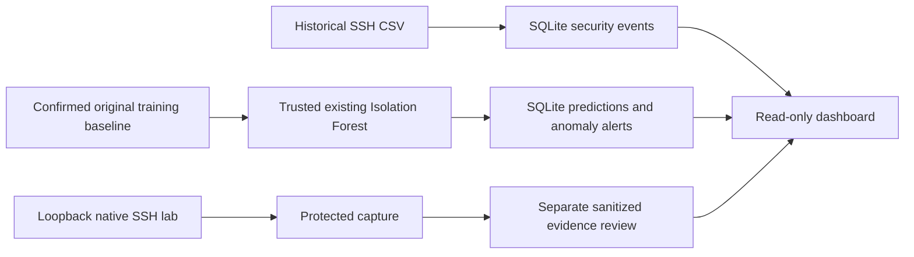

# AI-Powered Mini SIEM: SSH Security Anomaly Detection

A local educational proof of concept for **offline SSH behavioral anomaly
inference**, SQLite event/prediction/alert storage and a read-only Streamlit
dashboard. It is not real-time AI intrusion detection or a validated attack
classifier.

This final consolidation is local on `task-012-dashboard-simplification`.
Its changes are not committed, pushed or merged. Use the preserved working
checkout for review; a clone of main does not yet include the TASK-012 changes.

## Start, stop and restart on the existing Kali machine

```bash
cd ~/ai-mini-siem
source .venv/bin/activate
export MINI_SIEM_DATABASE="$PWD/data/mini-siem.db"
python -m streamlit run mini_siem/dashboard/app.py \
  --server.address 127.0.0.1 \
  --server.port 8501 \
  --browser.gatherUsageStats false
```

Open **http://127.0.0.1:8501** in the Kali browser. Stop with **Ctrl+C**.
Run the same block another day to restart; the environment variables must be
set in each new terminal. Stopping Streamlit does not delete stored data.

The database is local and **not included in GitHub**. The dashboard never creates
a populated database or runs the AI model. Keep it on localhost; no application
authentication is implemented. Never run Streamlit as root to read private logs.

## What is implemented

- Historical structured SSH CSV validation and event preservation.
- Trusted existing Isolation Forest inference on the confirmed original legacy
  baseline, with unchanged Normal/Anomaly labels and stored decision scores.
- Transactional SQLite persistence and alerts only for anomaly predictions.
- Four read-only dashboard pages with practical combined filters.
- A restricted native Kali OpenSSH lab and separate sanitized evidence review.
- Feature provenance/compatibility checks, dataset inventory and evaluation planning.



Native lab records and newly extracted historical features are **not** sent to
the legacy model. Historical event rows and IP-level predictions are different
observations, not verified event-to-anomaly links.

## Dashboard operation

| Page | Display and filters |
| --- | --- |
| Overview | Stored event/prediction/alert counts, Normal/Anomaly distribution, display-priority counts and UTC processing-day totals |
| Security Events | Event type, available peer-parsing status, Source IP and timestamps; literal type/IP, status and UTC date filters; separate sanitized native-evidence tab |
| Alerts | Unusual SSH Authentication Behavior, Source IP, Risk Level, creation timestamp and description; name/IP/risk/date filters |
| Predictions | Source IP, Normal/Anomaly classification, Risk Level and processing timestamp; IP/classification/risk/date filters |

**Refresh** rereads stored data; it does not collect logs or run inference.
The database path is configured outside the UI with MINI_SIEM_DATABASE. Internal
primary keys, batch/model identifiers, numerical scores and path inputs are hidden.
The shared **How to interpret these results** expander explains the limitations.

Full timezone-aware timestamps display as **YYYY-MM-DD HH:MM:SS UTC**; unavailable,
partial or timezone-ambiguous times display as **Unknown**. Event time, ingestion,
prediction processing and alert creation are distinct. Date filters use inclusive
UTC days and exclude Unknown times only when active. Day-chart buckets remain
dates; they are not invented midnight event timestamps.

Risk Level is a presentation-only priority derived from unchanged stored scores:

| Level | Rule |
| --- | --- |
| High | score < -0.1 |
| Medium | -0.1 <= score < 0 |
| Low | score >= 0 |

The -0.1 boundary is uncalibrated. These levels are not attack probabilities or
verified severity; High does not confirm an attack and Low does not prove safety.
Raw events and native evidence have no such model risk level. See the
[dashboard guide](docs/dashboard.md) for exact behavior.

An already authorized, readable sanitized V2 report is optional:

```bash
export MINI_SIEM_LAB_REVIEW="$PWD/reports/dashboard-evidence/review.json"
```

This is an operator-prepared local file, not a shipped asset. Keep it unset if
absent. The UI displays selected sanitized fields only; it does not open the
root-private capture, expose hashes or reverify the original evidence. Use the
[report-only handoff](docs/final-demonstration.md#prepare-native-evidence-without-exposing-the-capture),
never permission changes to the source capture.

## First-time setup on another Kali machine

Git, Python/venv and the requirements.txt packages are needed. Reuse the existing
working venv on an established machine. For a new machine, the following installs
the **published main baseline**, not the uncommitted TASK-012 consolidation:

```bash
cd ~
git clone --branch main https://github.com/Mohanad-Alghanim/ai-mini-siem.git
cd ai-mini-siem
python3 -m venv .venv
source .venv/bin/activate
python -m pip install -r requirements.txt
```

An approved final working-copy handoff or later approved published revision is
needed for the consolidated UI. Do not claim cloning alone installs unpublished
changes. Requirements are ranges, not a lockfile. The saved model requires its
original matching scikit-learn runtime; do not retrain or upgrade to bypass a
compatibility error. SQLite is part of Python; no external APIs are required.

A fresh clone has no private database, model or datasets. Arrange an approved
project-owned SQLite backup for the demonstration, or explicitly initialize a
**fresh empty** database:

```bash
python -m mini_siem.backend init --database data/mini-siem.db
```

Empty tables are then expected. Never overwrite existing
assets. New inference additionally requires the trusted original model/CSV pairing
and approved hashes through the [existing preparation workflow](docs/final-demonstration.md#prepare-the-data-choose-one-path).
No silent model training is part of installation or startup.

## Restricted laboratory and scope

The optional native lab binds strictly to **127.0.0.1:2222** with a disposable
restricted account, independent configuration/host key and fixed bounded scenarios:
success, one failed key attempt, three rate-limited failures, and a short forced
session/logout. It is not remotely accessible to teammates or a general vulnerable
target. Never expose it, widen the bind, send arbitrary attack traffic or modify
the existing system SSH service. Use the [lab guide](docs/kali-native-ssh-lab.md)
for explicit administrator authorization, stop controls and cleanup.

| Planned category | Current support |
| --- | --- |
| SSH brute-force indicators | Bounded repeated-key-failure evidence only; not validated brute-force detection |
| Password spraying | Unsupported; no suitable multi-account data/detector |
| Port scanning | Unsupported; no suitable network-flow data/detector |
| SQL injection | Unsupported; no suitable application data/detector |
| Unauthorized file modification | Unsupported; no file-integrity baseline/detector |
| Denial of Service | Unsupported; no suitable request/service metrics or detector |

No additional attack services, models or infrastructure are introduced.

## Data, model and validation limits

Recorded Kali observations include 2,000 historical SSH events, a 30-row original
baseline, 27 Normal/3 Anomaly predictions and 3 alerts. A native capture recorded
39 messages, four scenarios and six client attempts. These are supplied local
observations, not universal expected outputs or new measurements in this consolidation.

Legacy feature compatibility remains unverified for newly extracted inputs;
22 IPs previously differed from the baseline. Original generation provenance is
incomplete. Thirty correlated aggregates and training-baseline replay do not
establish generalization. No independent attack ground truth, trusted original
native event times or resolved per-experiment linkage is established. Do not
report accuracy, precision, recall or F1 against previous AI predictions.

**Existing test evidence only:** 427 full-suite tests passed before TASK-012;
TASK-012 passed 51 focused tests plus one event-identifier recheck. PR #14 had
separate documentation checks. **No additional tests were run for this combined
state.** Combined regression status, final links/commands and real Kali/browser
acceptance remain unverified. Details are in the [audit](docs/documentation-audit.md).

## Task history and final demonstration

Statuses below mean implementation complete, not independent scientific validation.
TASK-011 and final integration were consolidated in merged PR #13; Draft #12 was
not TASK-011's merge route. TASK-012 remains local and uncommitted.

| Task | Implementation / guide | Verified merge PR |
| --- | --- | --- |
| 001 | [Project setup](#first-time-setup-on-another-kali-machine) | [#1](https://github.com/Mohanad-Alghanim/ai-mini-siem/pull/1) |
| 002 | [SSH CSV analysis](docs/dataset-analysis.md) | [#2](https://github.com/Mohanad-Alghanim/ai-mini-siem/pull/2) |
| 003 | [Isolation Forest model](docs/ssh-anomaly-model.md) | [#3](https://github.com/Mohanad-Alghanim/ai-mini-siem/pull/3) |
| 004 | [SQLite backend/alerts](docs/siem-backend.md) | [#4](https://github.com/Mohanad-Alghanim/ai-mini-siem/pull/4) |
| 005 | [Read-only dashboard](docs/dashboard.md) | [#5](https://github.com/Mohanad-Alghanim/ai-mini-siem/pull/5) |
| 006 | [Historical ingestion](docs/ssh-log-ingestion.md) | [#6](https://github.com/Mohanad-Alghanim/ai-mini-siem/pull/6) |
| 007 | [Feature compatibility investigation](docs/feature-compatibility.md) | [#7](https://github.com/Mohanad-Alghanim/ai-mini-siem/pull/7) |
| 008 | [Provenance and feature contract](docs/feature-pipeline-strategy.md) | [#8](https://github.com/Mohanad-Alghanim/ai-mini-siem/pull/8) |
| 009 | [Inventory/evaluation planning](docs/dataset-inventory.md) | [#9](https://github.com/Mohanad-Alghanim/ai-mini-siem/pull/9) |
| 010 | [Native Kali lab](docs/kali-native-ssh-lab.md) | [#11](https://github.com/Mohanad-Alghanim/ai-mini-siem/pull/11) |
| 011 | [SSH evidence review](docs/ssh-evidence-review.md) | [#13](https://github.com/Mohanad-Alghanim/ai-mini-siem/pull/13) |

Use the [final demonstration guide](docs/final-demonstration.md) for the existing
DB → overview → events → predictions → alerts → separate native-evidence sequence.
It retains the single acceptance checklist and optional restricted lab procedure.
The [team guide](docs/team-kali-operations.md) covers handoff, restart and coordination.

## Troubleshooting and safe sharing

- Missing imports: activate the existing venv or use `.venv/bin/python` explicitly.
  Restore the compatible environment rather than changing system Python.
- Missing/empty database: check the configured path and approved private handoff;
  cloning does not create populated records.
- Port 8501 occupied: stop only your known dashboard using Ctrl+C. Do not kill an
  unknown process. Never solve a conflict by exposing the service externally.
- Protected capture or missing native report: keep source permissions and use an
  authorized sanitized report handoff. Other screens do not require native evidence.
- Git confusion: inspect status and preserve the uncommitted delivery files,
  including untracked source/test files. Do not switch branches, reset or clean
  this working copy to retrieve documentation. Local pytest.ini handling is in
  the [evidence guide](docs/ssh-evidence-review.md#safely-synchronize-pytestini-on-kali).

No private logs, databases, models, keys or generated reports belong in Git.
No screenshots or PDF are produced here. Publish only actual, reviewed and
redacted screenshots after approval; see [sharing guidance](docs/team-kali-operations.md#screenshots-and-sharing).
