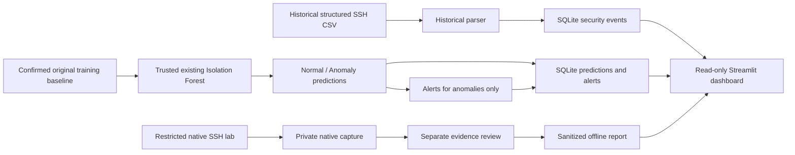

# AI-Powered Mini SIEM — SSH Security Anomaly Detection

A university graduation project for inspecting SSH security events, running
**offline behavioral anomaly inference**, storing results and reviewing them in
a local dashboard on Kali Linux. This is an educational proof of concept,
not validated real-time AI intrusion detection.

## Project overview

A Mini SIEM brings security observations into one place so an analyst can inspect
events and alerts. This project processes historical SSH events, uses an existing
Isolation Forest model to classify compatible IP-level feature records as Normal
or Anomaly, and stores predictions and anomaly-triggered alerts in SQLite.

The Streamlit dashboard displays those stored results. A separate restricted
native SSH laboratory records authentication/session evidence. **Lab evidence
is not passed to the legacy model.** No continuous ingestion, automatic live
inference or six-attack detection capability is claimed.

## Quick start: existing Kali installation

The existing checkout is `~/ai-mini-siem`. Start from a terminal on that machine:

```bash
cd ~/ai-mini-siem
source .venv/bin/activate
export MINI_SIEM_DATABASE="$PWD/data/mini-siem.db"
python -m streamlit run mini_siem/dashboard/app.py \
  --server.address 127.0.0.1 \
  --server.port 8501 \
  --browser.gatherUsageStats false
```

Open **http://127.0.0.1:8501** in the Kali browser. Press **Ctrl+C** in the
terminal to stop the dashboard. To restart another day, run the same commands;
reactivate `.venv` and set the database variable in each new terminal.
Stopping the dashboard does not delete stored events, predictions or alerts.

`data/mini-siem.db` is your **local existing database**, not a file distributed
through GitHub. If it is missing, the dashboard reports that rather than creating
a populated database. A fresh clone cannot reproduce private demonstration data
by itself. Keep Streamlit on localhost; there is no application authentication.

## Working features

| Component | Implemented behavior |
| --- | --- |
| Historical SSH processing | Read/validate structured CSVs; preserve events, including records without attributable IPs |
| Isolation Forest | Replay a trusted existing model on the confirmed original legacy baseline; no refitting during inference |
| Classifications | SourceIP, Normal/Anomaly label, score and processing time |
| SQLite | Event batches, event metadata/details, predictions and anomaly-only alerts with transactional persistence |
| Dashboard | Read-only overview, historical events, predictions, alerts and data/model limitations |
| Native Kali SSH lab | Loopback-only OpenSSH, disposable restricted account and fixed bounded scenarios |
| Evidence review | Integrity checks, conservative server-evidence categories, sanitized diagnostics and unresolved correlations |
| Research safeguards | Versioned feature contract, provenance/compatibility checks, inventory and evaluation planning |

## Architecture



The model's inputs are EventCount, UniqueEventTypes, FailedAuthCount,
InvalidUserCount and FailedAuthRate. SourceIP identifies a record; it is not
an AI feature. Historical events and aggregate predictions are separate batches,
not proof that a particular event caused an anomaly.

## Screenshots

No screenshots are included yet. Add only actual, reviewed captures of the
running application; do not generate dashboard images or invent results.

| Suggested screenshot | Before publishing |
| --- | --- |
| Overview | Verify counts against the selected database |
| Security Events | Hide operational IPs and other private identifiers |
| Predictions and Alerts | Redact IPs, model/batch identifiers where sensitive |
| Native SSH evidence | Show sanitized evidence categories, never raw messages or credentials |

Attach approved images to the documentation PR, or commit reviewed redacted
image files and link them here. See the [team guide](docs/team-kali-operations.md#screenshots-and-sharing).

## Requirements

| Activity | What is needed |
| --- | --- |
| View the dashboard | Kali Linux, Git, Python with a project virtual environment, requirements.txt dependencies and an initialized local SQLite database |
| View stored results | A project-owned populated database obtained through an approved private handoff; no model file is loaded by the dashboard |
| Generate new historical inference | The trusted existing model, its matching scikit-learn runtime and the confirmed original training baseline with approved hashes |
| View native evidence | A sanitized V2 review.json readable by the dashboard user; the root-private capture is not opened by the UI |
| Run the optional lab | Native OpenSSH server/client, ssh-keygen, ss, account utilities, Linux pidfd support and explicitly authorized administrator execution |

Python 3.12 is cloud-tested. `requirements.txt` declares Pandas, scikit-learn,
Streamlit, Plotly, Pytest and joblib ranges, not a locked environment. SQLite is
part of Python. Reuse the existing environment for the saved model; exact
scikit-learn compatibility is checked. Do not upgrade or retrain just to resolve
a presentation error. No API keys, external APIs, containers or extra VM are
required by the implementation.

## First-time installation on another Kali machine

```bash
cd ~
git clone --branch main https://github.com/Mohanad-Alghanim/ai-mini-siem.git
cd ai-mini-siem
python3 -m venv .venv
source .venv/bin/activate
python -m pip install -r requirements.txt
python -m pip check
python -m pytest -q
```

If Git or Python venv support is missing, ask your administrator to install
those prerequisites. Installing OpenSSH is separate and optional: package
scripts can start/restart a system SSH service, so follow the
[native lab guide](docs/kali-native-ssh-lab.md) before any such installation.
Never install project Python packages into system Python or run pip as root.

For a deliberately **empty** first run, explicitly initialize a new local database:

```bash
python -m mini_siem.backend init --database data/mini-siem.db
export MINI_SIEM_DATABASE="$PWD/data/mini-siem.db"
python -m streamlit run mini_siem/dashboard/app.py \
  --server.address 127.0.0.1 --server.port 8501 \
  --browser.gatherUsageStats false
```

Empty tables are expected. No model, attack log or populated database is created.
For the recorded demonstration, arrange an explicitly approved private handoff of
a project-owned SQLite backup and, only if needed, the matching original inputs,
trusted model/runtime records or sanitized review. These are not in Git.
Do not copy an active SQLite database's main file alone during writes.

To prepare a **fresh** populated demonstration database from confirmed original
assets, follow the existing [preparation workflow](docs/final-demonstration.md#b-demonstrate-loading-inference-and-alerts-in-a-fresh-database).
The `mini_siem.demo` CLI checks approved baseline/model hashes and requires
original-training-baseline confirmation. It will not overwrite a database or
silently train a replacement model. If the assets or provenance are absent,
new inference is blocked; use an approved existing database instead.

## Using the dashboard

| Screen | How to use it |
| --- | --- |
| Overview | Read database-derived prediction, Normal/Anomaly, alert, batch and event counts; inspect score and processing-date charts |
| Security Events | Inspect/filter stored historical metadata by batch or SourceIP; the separate Native SSH lab evidence tab reads a sanitized V2 review |
| Predictions | Filter Normal/Anomaly, batch, model and literal SourceIP substring |
| Alerts | Filter stored anomaly alerts by batch/model/SourceIP; compare their prediction identifiers |
| Data Sources / System Information | Read offline scope, score conventions, timestamp meaning and compatibility/privacy limits |

**Refresh** rereads the database/report. Widget interactions also rerun the page;
there is no automatic polling, ingestion or model execution. Filters affect the
selected table, not the global Overview KPIs.

Scores use scikit-learn `decision_function`: **negative = Anomaly; zero or positive
= Normal**. Lower means more unusual, not a higher attack probability. An alert
records a model anomaly, not a confirmed intrusion. Processing timestamps are UTC;
missing original years/timezones are not reconstructed.

To select an already approved, reader-accessible native report before launching:

```bash
export MINI_SIEM_LAB_REVIEW="$PWD/reports/dashboard-evidence/review.json"
```

That path is an operator-prepared local report, not a shipped file. If it is
absent, leave the variable unset and use the other screens. The
[report handoff procedure](docs/final-demonstration.md#prepare-native-evidence-without-exposing-the-capture)
shares only sanitized output, never raw capture files or credentials. Do not
run Streamlit as root to get around capture permissions.

## Project tasks: TASK-001 through TASK-011

Statuses below describe **implementation**, not independent scientific validation.
PR links and merge history are verified from `main`; task-time test counts in
technical guides are historical records, not the current suite size.

| Task | Title | Implemented | Final status | Guide | Verified PR |
| --- | --- | --- | --- | --- | --- |
| TASK-001 | Project initialization | Modular packages, dependencies, ignore rules and smoke tests | Complete, merged | [Setup](#first-time-installation-on-another-kali-machine) | [#1](https://github.com/Mohanad-Alghanim/ai-mini-siem/pull/1) |
| TASK-002 | SSH dataset analysis | CSV validation, quality/relationship checks and reports | Complete, merged | [Dataset analysis](docs/dataset-analysis.md) | [#2](https://github.com/Mohanad-Alghanim/ai-mini-siem/pull/2) |
| TASK-003 | Isolation Forest | Five-feature training/prediction API, persistence and score convention | Complete, merged; evaluation limited | [Model](docs/ssh-anomaly-model.md) | [#3](https://github.com/Mohanad-Alghanim/ai-mini-siem/pull/3) |
| TASK-004 | SQLite and alerts | Transactional batches/predictions, anomaly alerts and retry safety | Complete, merged | [Backend](docs/siem-backend.md) | [#4](https://github.com/Mohanad-Alghanim/ai-mini-siem/pull/4) |
| TASK-005 | Streamlit dashboard | Read-only KPIs, charts, prediction/alert filters | Complete, merged; later extended in final integration | [Dashboard](docs/dashboard.md) | [#5](https://github.com/Mohanad-Alghanim/ai-mini-siem/pull/5) |
| TASK-006 | Historical SSH ingestion | Parser v2, event preservation, aggregation and explicit details storage | Complete, merged | [Historical ingestion](docs/ssh-log-ingestion.md) | [#6](https://github.com/Mohanad-Alghanim/ai-mini-siem/pull/6) |
| TASK-007 | Compatibility investigation | Explainable feature differences; incompatible inference stays blocked | Complete, merged; compatibility not demonstrated | [Compatibility](docs/feature-compatibility.md) | [#7](https://github.com/Mohanad-Alghanim/ai-mini-siem/pull/7) |
| TASK-008 | Provenance and contract | Provenance audit, versioned feature contract and model strategy | Complete, merged; no new model authorization | [Strategy](docs/feature-pipeline-strategy.md) | [#8](https://github.com/Mohanad-Alghanim/ai-mini-siem/pull/8) |
| TASK-009 | Inventory and evaluation | Metadata quality/readiness and leakage-aware split planning | Complete, merged; plans are not performance results | [Inventory](docs/dataset-inventory.md) | [#9](https://github.com/Mohanad-Alghanim/ai-mini-siem/pull/9) |
| TASK-010 | Native Kali SSH lab | Restricted loopback OpenSSH, bounded scenarios and native telemetry | Complete, merged; local collection recorded | [Lab](docs/kali-native-ssh-lab.md) | [#11](https://github.com/Mohanad-Alghanim/ai-mini-siem/pull/11) |
| TASK-011 | SSH evidence review | Integrity checks, conservative V2 categories, diagnostics and correlation review | Complete, consolidated in PR #13; event linkage unresolved | [Evidence](docs/ssh-evidence-review.md) | [#13](https://github.com/Mohanad-Alghanim/ai-mini-siem/pull/13) |

### Final Sprint

[PR #13](https://github.com/Mohanad-Alghanim/ai-mini-siem/pull/13), merged at
`80e4a5e`, consolidated TASK-011 and the final demonstration integration. It added
the guarded fresh-database workflow, Security Events screen and separate native
evidence display. **Draft PR #12 was not TASK-011's merge route.** Use `main` for
operation, not the old task/final-sprint branches.

The [graduation demonstration guide](docs/final-demonstration.md) has the full
presentation sequence and one acceptance checklist. Implementation is complete
for the accepted SSH proof-of-concept scope. Independent detection evaluation
and the original six-attack real-time research scope are not complete.

## Controlled security laboratory

The optional native lab listens strictly on **127.0.0.1:2222**. It is local to
Kali and **not remotely accessible to teammates**. It uses an independent temporary
configuration/host key and a disposable restricted account; it does not edit the
system sshd configuration or stop/restart an existing SSH service.

Only four reviewed scenarios are available: success, one failed key attempt,
three rate-limited failed key attempts, and success followed by session logout.
There are no arbitrary target/account inputs, password lists or unrestricted
shells. It is not a general-purpose vulnerable server and must not receive
arbitrary attack traffic. Never widen the binding to `0.0.0.0`, add forwarding
or expose port 2222 publicly. Logs and credentials stay private, separate from
legacy inference. Follow the [native lab guide](docs/kali-native-ssh-lab.md) for
privileges, verification, stop controls, cleanup and system-service comparisons.

## Team attack simulation scope

| Planned category | Current support | Compatible telemetry available? | AI detection implemented? | Controlled simulation supported? | Missing |
| --- | --- | --- | --- | --- | --- |
| SSH brute-force indicators | Limited repeated-authentication-failure evidence | SSH logs exist; native features are **not** legacy-model compatible | Historical SSH anomaly inference only; no validated brute-force classification | Fixed three-key-failure scenario only | Verified attack labels, compatible new-data pipeline and independent evaluation |
| Password spraying | Unsupported | No suitable multi-account spraying dataset established | No | No | Multi-account/context evidence and a validated detector |
| Port scanning | Unsupported | No suitable network flow dataset established | No | No | Authorized network telemetry and detector/evaluation |
| SQL injection | Unsupported | No suitable HTTP/application dataset established | No | No | Authorized application telemetry and detector/evaluation |
| Unauthorized file modification | Unsupported | No file-integrity baseline/log source established | No | No | File-integrity telemetry and change detection |
| Denial of Service | Unsupported | No suitable request/server-metrics dataset established | No | No | Controlled service telemetry, exposure context and detector/evaluation |

Repeated SSH key failures are neither password spraying nor validated brute-force
detection. Future teammate experiments require explicitly authorized isolated
targets and separately validated data; the protected SSH listener is not the
default target for unrelated attacks. No vulnerable targets or flood generators
are provided.

## Data and model limitations

These figures are **previously recorded Kali observations**, not universal expected
outputs, committed datasets or new measurements from this documentation audit:

| Observation | Recorded value / meaning |
| --- | --- |
| Historical structured SSH input | 2,000 events |
| Original baseline | 30 IP-level feature rows |
| Existing historical predictions | 27 Normal, 3 Anomaly |
| Existing alerts | 3 anomaly alerts |
| Historical extraction review | 1,647 attributed events, 353 without supported attribution; 22 IPs differed from the legacy baseline |
| Native lab capture | 39 records, 31 adapter-supported, 8 unsupported, 23 with source IP; four scenarios and six client attempts |
| Native evidence status | Integrity review recorded; V1 classified all 39 as ambiguous; V2 compatibility fix is implemented, but updated private V2 category counts were not supplied for this audit |

The legacy baseline producer is not recovered. Matching columns or IP sets does
not prove equivalent feature semantics; generated historical/native features
remain blocked from that model. Original-baseline replay is a demonstration on
training data, not independent validation. The 30 correlated aggregates do not
support strong generalization claims.

No independent attack ground truth or trusted original native event timestamps
are established. Per-experiment correlation remains unresolved; client exit codes
and intended scenarios do not label individual events. Accuracy, precision,
recall and F1 cannot be claimed from prior model predictions or unverified
heuristics. Current counts must always be read from the selected local assets.

## Troubleshooting

| Problem | Safe action |
| --- | --- |
| Wrong Python / inactive venv | Run `source .venv/bin/activate`; inspect `python -c 'import sys; print(sys.executable)'` |
| Missing sklearn or Streamlit | First test `.venv/bin/python -c 'import sklearn, streamlit'` and `.venv/bin/python -m pip check`; restore the existing environment before considering dependency installation |
| Existing database unavailable | Check the selected path and authorized access; use an approved backup or explicitly initialize a fresh empty database, never overwrite the old one |
| Port 8501 occupied | Stop your known dashboard with Ctrl+C; inspect `ss -ltnp 'sport = :8501'`; do not kill an unknown process. An approved alternative local port such as 8502 can be selected with `--server.port` |
| Root-private capture unreadable | Expected for ordinary users; keep its permissions. Use an authorized analyst and a sanitized report handoff, never root Streamlit |
| Missing native review report | Generate/select an authorized V2 review, or leave the path blank; other dashboard screens remain available |
| Missing/untrusted model or runtime mismatch | View existing stored predictions; recover the trusted artifact and matching runtime. Do not retrain or disable compatibility checks |
| Fresh clone has empty tables | Private demonstration assets are not shipped. Arrange approved handoff or use the guarded preparation workflow |
| Pytest scans private data | Use tracked pytest.ini with testpaths = tests; run from the repository root without explicitly selecting data/ |
| Branch/pull confusion | Inspect `git status --short` and `git branch --show-current`; preserve unrelated work, then use reviewed main and `git pull --ff-only origin main`. Do not reset/clean private files |

The [team operator guide](docs/team-kali-operations.md) covers restart, handoff,
coordination, permitted laboratory activity and the short pre-demo checklist.

## Repository and documentation

The tree below lists actual tracked top-level paths and package groups; private
runtime files are deliberately omitted.

```text
ai-mini-siem/
├── README.md
├── requirements.txt
├── pytest.ini
├── .gitignore
├── .streamlit/config.toml
├── config/                 # Dataset schemas and versioned SSH feature contract
├── docs/                   # Technical, operator and demonstration guides
├── mini_siem/
│   ├── analysis.py
│   ├── backend.py
│   ├── datasets.py
│   ├── demo.py
│   ├── evidence_review.py
│   ├── feature_compatibility.py
│   ├── feature_contract.py
│   ├── kali_ssh_lab.py
│   ├── ssh_logs.py
│   ├── alerts/
│   ├── dashboard/
│   ├── evaluation/
│   ├── ingestion/
│   ├── ml/
│   ├── native_lab/
│   ├── preprocessing/
│   └── storage/
└── tests/
```

| Need | Maintained guide |
| --- | --- |
| Team start/restart, handoff and safe operation | [Team Kali operations](docs/team-kali-operations.md) |
| End-to-end presentation and acceptance checklist | [Final demonstration](docs/final-demonstration.md) |
| Dashboard screens and read-only safeguards | [Dashboard](docs/dashboard.md) |
| Backend schema, transactions and retry behavior | [SQLite backend](docs/siem-backend.md) |
| Model API and score/persistence reference | [SSH anomaly model](docs/ssh-anomaly-model.md) |
| CSV quality checks | [Dataset analysis](docs/dataset-analysis.md) |
| Historical parser and storage | [Historical ingestion](docs/ssh-log-ingestion.md) |
| Feature differences and provenance | [Compatibility](docs/feature-compatibility.md), [audit](docs/feature-provenance-audit.md), [strategy](docs/feature-pipeline-strategy.md), [contract CLI](docs/feature-contract-cli.md) |
| Inventory and independent evaluation design | [Inventory](docs/dataset-inventory.md), [evaluation](docs/dataset-evaluation.md) |
| Restricted native lab and review | [Lab](docs/kali-native-ssh-lab.md), [evidence review](docs/ssh-evidence-review.md) |
| This documentation audit and validation sources | [Documentation audit](docs/documentation-audit.md) |

[Repository](https://github.com/Mohanad-Alghanim/ai-mini-siem) ·
[Pull requests](https://github.com/Mohanad-Alghanim/ai-mini-siem/pulls)

## Project status

The accepted deliverable is a working local SSH Mini SIEM demonstration with
historical anomaly inference, persistent predictions/alerts, a read-only dashboard
and a restricted native laboratory. It has recorded Kali observations and
synthetic automated integration checks. It is not a completed six-attack
real-time detector or a scientifically validated intrusion-detection product.
No private datasets, databases, model artifacts, captures, keys or reports belong
in Git. No screenshots or performance metrics are fabricated here.
