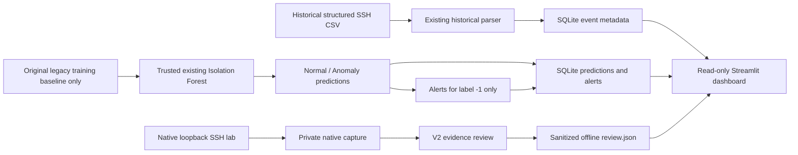

# Final graduation demonstration: AI-Powered Mini SIEM

This is a local educational proof of concept: offline SSH behavioral anomaly
inference, SQLite predictions/alerts, historical event inspection, a native
loopback SSH lab and separate evidence review. It is **not real-time AI intrusion
detection**, a validated attack classifier or a six-attack production SIEM.
No infrastructure beyond the existing Kali machine is required.

## Architecture and what the AI does



The model uses only EventCount, UniqueEventTypes, FailedAuthCount,
InvalidUserCount and FailedAuthRate. SourceIP identifies a record; it is not a
training feature. `decision_function < 0` means Anomaly and zero or above means
Normal. Lower scores indicate more unusual behavior, not attack probability.
Application logic creates one stored alert per anomaly prediction. Normal
predictions do not generate alerts. The dashboard never fits or invokes a model.

The original baseline has 30 aggregated IP records. Replaying that training
baseline demonstrates software integration, not independent evaluation. Old
baseline generation provenance is incomplete; generated historical features
have documented differences and must not be substituted. The original artifact
contains no training-input hash, so provenance cannot be proved automatically.
The demo command requires explicit operator confirmation and approved byte hashes
for the known original training CSV and model, not just a matching filename/schema.
A newly computed hash of an unknown CSV is **not compatibility evidence**.
If the original pairing cannot be independently confirmed, do not confirm it:
use the previously stored predictions instead, and report replay as blocked.
There is no override for new extracted features and no retraining in this workflow.

## Install / select the environment

From your existing repository on Kali, after reviewing the final branch:

```bash
git fetch origin
git switch final-sprint-mini-siem
source .venv/bin/activate
python -c 'import sys, sklearn, streamlit; print(sys.executable); print(sklearn.__version__, streamlit.__version__)'
python -m pip check
python -m pytest -q
```

Reuse the existing working virtual environment; do not upgrade it casually.
For a new installation only, use `python3 -m venv .venv`, activate it and
`python -m pip install -r requirements.txt`. The existing artifact requires the
**exact scikit-learn version recorded when it was saved**. If loading fails for
version mismatch, restore the original trusted runtime/dependency versions;
do not retrain to make a presentation work. Python model artifacts can execute
code: use only your own reviewed artifact. No system Python modifications or
new system packages are needed for the dashboard/inference path.

If an untracked local pytest.ini blocks checkout, follow the narrow backup and
comparison procedure in [SSH evidence review](ssh-evidence-review.md). Do not
use git clean, force checkout or discard unrelated changes/private files.

## Prepare the data: choose one path

### A. Reuse the verified existing database (fastest)

```bash
python -m mini_siem.backend stats --database data/mini-siem.db
export MINI_SIEM_DATABASE="$PWD/data/mini-siem.db"
```

This reads existing predictions/alerts/events and performs no inference. No
record is regenerated or overwritten. If events have already been ingested,
they appear on Security Events. Counts must come from this database, not slides.
The previously reported 30 predictions / 27 Normal / 3 Anomaly / 3 alerts and
2,000 historical events are external observations, not hardcoded targets or
new cloud-verified results. A database with no stored events can still show
predictions, but the event demonstration is incomplete until a valid event
source has been ingested via the existing reviewed workflow or path B below.

### B. Demonstrate loading, inference and alerts in a fresh database

Only use this when you have the trusted original CSV/model pairing and the
historical structured CSV. Replace the paths and the two approved hash values
below with actual trusted records. Do not use generated `ssh_features.csv`, a
new lab aggregation, prediction exports or another schema-compatible CSV.

```bash
python -m mini_siem.demo \
  --database data/graduation-demo.db \
  --historical data/private/OpenSSH_2k.log_structured.csv \
  --baseline data/private/ssh_baseline_features.csv \
  --model models/ssh_isolation_forest.joblib \
  --original-baseline-sha256 YOUR_APPROVED_ORIGINAL_TRAINING_CSV_SHA256 \
  --model-sha256 YOUR_APPROVED_TRUSTED_MODEL_SHA256 \
  --trust-model --confirm-original-training-baseline
python -m mini_siem.backend stats --database data/graduation-demo.db
export MINI_SIEM_DATABASE="$PWD/data/graduation-demo.db"
```

Actual filenames are configurable; no private model path is assumed to exist.
The command checks hashes, validates the exact six-column 30-row baseline,
parses historical events without deriving model inputs, and calls the existing
inference/storage/alert code without fitting. It prepares the existing event
extension only in the **new** database, then publishes the complete result.
If inference fails there is no published partial database. Existing databases
and input files are never overwritten. Repeating the command with the same
output refuses; use path A to inspect that result or choose another fresh path.
Publishing needs a local Linux filesystem supporting hard links.

No attempt is made to join an individual historical event to an IP-level anomaly
as proof that it caused the prediction. These are separately identified batches.

## Prepare native evidence without exposing the capture

TASK-011 is included, including the OpenSSH 10.5 CRLF and fixed forced-command
compatibility correction. Unknown message forms remain ambiguous; they do not
block the rest of the demonstration or become attack labels.

In the **existing authorized analysis context**, using the trusted project venv:

```bash
.venv/bin/python -m mini_siem.evidence_review \
  --collection-dir data/native-lab/capture-001 --diagnostics-only
.venv/bin/python -m mini_siem.evidence_review \
  --collection-dir data/native-lab/capture-001 \
  --output-dir reports/native-lab/graduation-review-001
```

Use a fresh report path. Never chmod/chown the original capture or its parents,
copy private keys, run Streamlit as root, or expose its port publicly. The
dashboard needs only the generated **sanitized review.json**, not the capture.
If the authorized analyst runs in a separate root context, have that analyst
explicitly hand over **only the generated review.json** into a fresh private
presentation directory owned by the dashboard user, with owner-only access.
This is a derived report, not a copy of raw logs/credentials. Keep all source
permissions unchanged; review exactly what is being shared. No automated
privilege or permission changes are performed by this project.

If the normal dashboard user can already read the generated report, set that
path directly. Otherwise, after the administrator has reviewed/authorized this
sanitized report, the following **optional explicit report-only handoff** runs
from the normal user's terminal. It reads only the generated JSON with `sudo cat`
and creates a new owner-only copy; it never changes source/capture permissions.
No Python or dashboard runs elevated in this handoff:

```bash
mkdir -m 700 reports/dashboard-evidence
(umask 077; set -o noclobber; sudo cat "$PWD/reports/native-lab/graduation-review-001/review.json" > reports/dashboard-evidence/review.json)
```

Use a fresh handoff directory/file; do not replace an existing report blindly.
If the privileged read fails, remove only the newly created empty output after
review and retry through the authorized owner. Never copy raw logs or keys this way.
Set the actual reader-accessible sanitized path (adjust if no handoff was needed):

```bash
export MINI_SIEM_LAB_REVIEW="$PWD/reports/dashboard-evidence/review.json"
```

The UI checks report consistency but does not reverify the private capture.
The CLI verifies evidence integrity before generating the report. The externally
reported 39 records, 31 adapter-supported, 8 unsupported and 23 with a source IP
must be checked locally, never invented. Evidence classification counts may
change under V2. Experiment assignments remain unresolved: collection/run times
are not trusted original event times, and client exit codes are not server
proof. Training and inference remain disabled **for all this native evidence**.

## Start and present the dashboard

As the normal dashboard user, from the repository root:

```bash
python -m streamlit run mini_siem/dashboard/app.py --server.address 127.0.0.1 --server.port 8501
```

Open `http://127.0.0.1:8501` in the Kali browser. Configuration disables usage
telemetry. There is no authentication: keep the service local. In presentation
order:

1. **Overview:** show live database-derived Normal/Anomaly, alert, batch and event
   counts and score charts. State that anomalies are unusual behavior, not attacks.
2. **Security Events → Stored historical events:** show actual stored event
   metadata; filter batch or SourceIP. Explain missing original timestamp/year.
3. **Predictions:** select Normal and Anomaly, then batch/model filters. Show
   SourceIP, score and processing timestamp; lower scores are more unusual.
4. **Alerts:** show anomaly-triggered alerts and matching batch/model identifiers.
   On the fresh demo database, alert count equals anomaly count; historical
   multi-model databases may contain more than one observation per IP.
5. **Security Events → Native SSH lab evidence:** select the sanitized V2 report.
   Show counts, event references and server evidence categories, separately from
   AI prediction/alert tables. Explain that none of these native events triggered
   the legacy model, and no event-to-experiment assignment is verified.
6. **Data Sources / System Information:** show provenance, offline scope and
   score conventions. Use **Refresh** after a separate process changes stored
   data or regenerates an authorized report; there is no live polling/inference.

Do not put raw messages, credentials, private paths or IP-level exports on public
slides. Operational IP tables are intended only for the authorized local demo.
Stop Streamlit using Ctrl+C after presenting.

## Demonstrate the existing controlled SSH scenarios

A live SSH demonstration is optional if the protected existing capture is already
available; it must never be replaced by fake data. For a live run, use the exact
reviewed root procedure in [native lab guide](kali-native-ssh-lab.md), with a
**fresh** runtime `/run/mini-siem-native-graduation`. The existing runtime and
capture must not be overwritten. The administrator must trust the code/env and
verify existing system service state before/after, as documented there.
After that authorization, the fixed commands are:

```bash
# Explicit root-only lab operations on Kali, after the guide's prerequisite checks.
lab_python="$PWD/.venv/bin/python"
sudo "$lab_python" -m mini_siem.kali_ssh_lab prepare --runtime /run/mini-siem-native-graduation
sudo "$lab_python" -m mini_siem.kali_ssh_lab start --runtime /run/mini-siem-native-graduation
sudo "$lab_python" -m mini_siem.kali_ssh_lab verify --runtime /run/mini-siem-native-graduation
sudo "$lab_python" -m mini_siem.kali_ssh_lab scenario --runtime /run/mini-siem-native-graduation --name success
sudo "$lab_python" -m mini_siem.kali_ssh_lab scenario --runtime /run/mini-siem-native-graduation --name single-failure
sudo "$lab_python" -m mini_siem.kali_ssh_lab scenario --runtime /run/mini-siem-native-graduation --name three-failures
sudo "$lab_python" -m mini_siem.kali_ssh_lab scenario --runtime /run/mini-siem-native-graduation --name session-logout
sudo "$lab_python" -m mini_siem.kali_ssh_lab stop --runtime /run/mini-siem-native-graduation
sudo "$lab_python" -m mini_siem.kali_ssh_lab collect --runtime /run/mini-siem-native-graduation --output-dir "$PWD/data/native-lab/graduation-capture-001"
# Preserve collected evidence before removing only this new disposable environment.
sudo "$lab_python" -m mini_siem.kali_ssh_lab cleanup --runtime /run/mini-siem-native-graduation
```

There are six attempts total, only the fixed local disposable account/keys, a
maximum of three failed attempts with two-second gaps and ten-second attempt
timeouts. Successful sessions run forced `/bin/true` and close. This is not a
password-list attack. Occupied 2222 means refuse; never kill/reconfigure its owner.
Ctrl+C or `request-stop --runtime /run/mini-siem-native-graduation` stops further
attempts; the reviewed `stop` command signals only the owned process. Check system
service hashes/PID and disappearance of the lab listener using the existing guide.
Review this new capture separately; it does not automatically update predictions.

## Six-scenario scope: honest completion status

The six categories below follow the existing project data-source planning. No
claim is made that a single SSH dataset supports unrelated attack types.

| Scenario | Deliverable in this sprint | Limitation / missing requirement |
| --- | --- | --- |
| SSH repeated authentication failures / brute-force indicators | Existing three-failure disposable-key scenario, explicit server failure evidence, historical behavioral anomaly replay | Conservative collection only; no high-volume attack, validated brute-force classification or live AI |
| Password spraying | Not implemented | Multiple-account/context evidence and a suitable detector/evaluation are absent; one-account key failures are not spraying |
| Port scanning | Not implemented | No network flow dataset, labels or scan detector; SSH anomalies do not establish scanning |
| SQL injection | Not implemented | No HTTP/application dataset or verified SQLi detector; no web target added |
| Unauthorized file modification | Not implemented | No file-integrity baseline/telemetry or file-change detector |
| DoS | Not implemented | No controlled service/request-metrics dataset, exposure or DoS detector; no traffic flood added |

Successful authentication and logout are normal control scenarios, not extra
attack detectors. Implementing the five unsupported attack categories would
require data and detection work outside the existing minimal system; this sprint
does not fabricate success or silently add risky simulations/services.

## Single final Kali acceptance checklist

- [ ] Review `final-sprint-mini-siem` (includes TASK-011); keep PRs unmerged until approval.
- [ ] Confirm branch, clean/preserved Git changes, tracked pytest.ini and existing venv imports.
- [ ] Run full pytest and pip check; retain actual results privately.
- [ ] Select existing DB (A) or confirm original training assets and build a fresh DB (B).
- [ ] Check actual database counts; historical events are visible and original files unchanged.
- [ ] If B is used, confirm Normal + Anomaly = baseline records and alerts = Anomaly.
- [ ] Run V2 diagnostic/review on authorized native evidence; no capture/credential permissions change.
- [ ] Make only the sanitized report readable to the dashboard user; no root Streamlit session.
- [ ] Launch on 127.0.0.1:8501; complete all six presentation steps and verify filters/Refresh.
- [ ] Confirm native events are separate from legacy AI; no live monitoring or attack-accuracy claim.
- [ ] If live scenarios are shown, verify loopback PID/address, limits, normal controls and failure evidence.
- [ ] Stop/clean up only the newly created lab; verify existing SSH config/service and original capture unchanged.
- [ ] State unsupported attack categories, 30-row training replay, unverified labels/time/correlation and no independent evaluation.
- [ ] Stop the dashboard. Do not merge or start additional work without approval.

## Automated validation

Cloud result: **427 tests passed**, including all 421 existing tests and six
focused integration/failure cases. Tests exercise original-baseline inference
without fitting, event persistence, prediction/alert consistency, all dashboard
pages, sanitized native evidence, filters, failure cleanup and no overwrite.
Python compilation, dependency consistency, whitespace checks and an actual
loopback Streamlit HTTP health check also passed. No new Python dependencies
were added.

## Remaining blockers and validation boundary

Cloud tests use synthetic fixtures, including a temporary synthetic test model;
no private dataset/artifact is bundled or trained for presentation. Real Kali
capture, original model/CSV pairing, runtime compatibility, actual model counts,
privileged lab behavior and browser acceptance require the checklist above.
An unavailable/mismatched model environment or unverifiable baseline pairing
blocks new inference, not inspection of previously stored predictions. Missing
authorized report access blocks the native-evidence panel, not the rest of the UI.
Unsupported messages remain ambiguous. No independent labels, trusted original
event timestamps, adequate holdout data or production/generalization evidence
exists. The original full six-attack, real-time AI scope is therefore incomplete;
the honest deliverable is the integrated historical SSH proof of concept described here.
