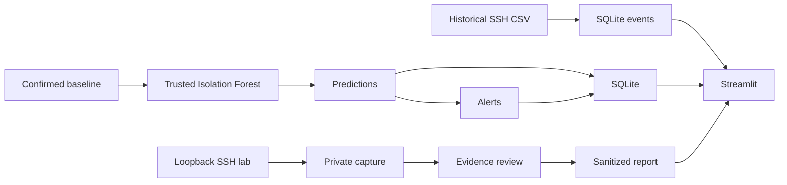

# Architecture

The model inputs are EventCount, UniqueEventTypes, FailedAuthCount, InvalidUserCount, FailedAuthRate. SourceIP is an identifier only. Native lab evidence is not compatible inference input. See [[07 - Data Catalog]].
